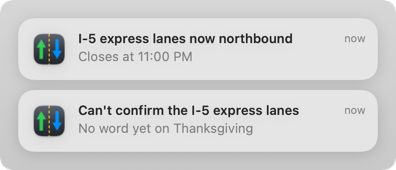

# I-5 Express for Mac Menu Bar

[](https://github.com/andrewmacheret/i5-macos-menubar/actions/workflows/build.yml) [](https://github.com/andrewmacheret/i5-macos-menubar/actions/workflows/canary.yml) [](https://github.com/andrewmacheret/i5-macos-menubar/blob/main/LICENSE)

A macOS menu bar app that shows which way Seattle's I-5 express lanes are running right now, and whether they're open at all.

The data comes from [i5-server-lambdas](https://github.com/andrewmacheret/i5-server-lambdas), which reads WSDOT's express lanes page and highway alerts every 15 minutes and has two AI models read each new notice. The app downloads the server's timeline and works out the status from it, minute by minute, even offline.

<picture>
  <source media="(prefers-color-scheme: dark)" srcset="docs/icons-dark.png">
  
</picture>

Click the icon for details: today's and tomorrow's schedule, travel times, traffic cameras, upcoming changes, planned closures, and links to live sources.

<p>
  
  &nbsp;
  
</p>

## Features

### Menu bar

- A colored badge shows the current state: green **N** for northbound, blue **S** for southbound, red **✕** for closed.
- An orange dot appears on the badge when the lanes switch within 15 minutes.
- An amber **⚠** replaces the badge whenever the app can't confirm the status. See [When to trust it](#when-to-trust-it).
- You can show a countdown to the next change next to the icon. It's off by default.
- A gray **?** shows while the app is checking, like right after your Mac wakes with old data.
- Hover over the icon to see the next change. Right-click it to refresh, open WSDOT's page, or quit.

<picture>
  <source media="(prefers-color-scheme: dark)" srcset="docs/menubar-dark.png">
  
</picture>

### Popover

The sections follow the [web version](https://andrewmacheret.com/projects/i5/), in the same order and wording. The popover scrolls when it's taller than the screen.

- **Status:** the current direction and what happens next, like "Closes at 11:00 PM · 8h".
- **Warnings:** each reason the status can't be confirmed, then "Check a live source before you drive" with links to WSDOT Traffic on Bluesky, the traffic cameras and WSDOT's page.
- **Notices:** what WSDOT says about today, each with a More info link.
- **Timelines:** colored bars for today and tomorrow, with a marker for the current time. Hours the server isn't sure about are striped.
- **Travel times:** Seattle ↔ Everett in the express lanes and the regular lanes, from WSDOT's sensors, with how much the express lanes save and the usual time. Hidden when the reading is more than 30 minutes old.
- **Cameras:** closed until you open it. Shows the express lane cameras first, with a button for every camera along I-5 in Seattle. Each picture has its milepost and a map link, refreshes every 5 minutes while open, and opens full size in your browser when clicked.
- **Coming up:** the next four changes with countdowns. A ⚠ marks days that may not go as planned.
- **Planned changes:** closures and early closings in the next two weeks, each as a list of times (20 shown, then "…" for the rest), with WSDOT's own words and a More info link.
- **Regular schedule and sources:** the weekly schedule as posted, and links to every page the data comes from.
- **Footer:** when the server last checked WSDOT, which models read the notices, a refresh button (⌘R), and the settings menu.

Times are always Seattle time. If your Mac uses another time zone, the popover says so.

### Notifications

Turn on **Notify when lanes change** in the gear menu to get:

- an alert when the lanes switch direction, open or close;
- an alert when the app goes from confirmed to "can't confirm", with the reason.

To keep alerts useful, the app skips:

- the 15-minute weekday switchover gap;
- any change that happened while your Mac was asleep;
- data that's only old, like when you're offline or just woke the Mac. The menu bar still shows it;
- the few minutes while the server's models read a new WSDOT notice.

A "can't confirm" alert also waits until the lanes are scheduled to open. So a Thanksgiving alert comes at 5 AM, not midnight.

<picture>
  <source media="(prefers-color-scheme: dark)" srcset="docs/notifications-dark.png">
  
</picture>

### Settings

The gear menu in the popover and the right-click menu on the icon are the same menu. It can refresh, open WSDOT's page and check for updates. It also turns the countdown, notifications, launch at login and automatic updates on or off. Each toggle reads its real state back from macOS, so it always shows what's actually set.

<picture>
  <source media="(prefers-color-scheme: dark)" srcset="docs/menus-dark.png">
  
</picture>

### Updates

The app checks GitHub for a new version every 6 hours. When there is one, it downloads it, checks that it was signed with the project's update key, installs it and relaunches, all in a second or two with no prompts. Turn off **Install updates automatically** in the gear menu to stop that, or use **Check for Updates…** to check now. The updater is [Sparkle](https://sparkle-project.org).

Versions before 1.1.0 can't update themselves, so install 1.1.0 by hand once.

The menu bar, notification and menu images are previews drawn by the app's snapshot mode (`make screenshots`), using the same icons and message text as the running app.

## When to trust it

WSDOT doesn't publish a live feed for the express lanes. The [I-5 server](https://github.com/andrewmacheret/i5-server-lambdas) reads [WSDOT's express lanes page](https://wsdot.wa.gov/travel/roads-bridges/express-lanes) and highway alerts, and marks every hour it isn't sure about. See [its README](https://github.com/andrewmacheret/i5-server-lambdas#doubts) for when it has doubts, like a holiday WSDOT hasn't posted hours for, or a notice the two models read differently.

The app only shows **N**, **S** or **✕** when all of these are true:

- The server read WSDOT in the last 2 hours, and WSDOT answered.
- The server has no doubts about right now.
- Your Mac's clock agrees with the server's, within 5 minutes.
- WSDOT's travel time sensors don't show traffic going the other way, or none while the lanes should be open.

Otherwise it shows an amber **⚠**, explains why, and links to [WSDOT Traffic on Bluesky](https://bsky.app/profile/traffic.wsdot.wa.gov), the traffic cameras and WSDOT's page, so you can check a live source. While the server's models are reading a new notice, or while the app downloads after its copy got old, it shows a gray **?** instead.

The app checks the server every 5 minutes, when your Mac wakes, when the network comes back, and when you press ⌘R. If the server can't be reached, it keeps using the last good copy, and shows ⚠ once that copy is more than 2 hours old.

It can't know about a closure WSDOT hasn't posted yet, like an emergency repair announced only on social media.

## Install

You need macOS 14 or later. It runs on Apple silicon and Intel Macs.

### Homebrew

```bash
brew install --cask andrewmacheret/tap/i5-express
```

Then open **I-5 Express** from Applications. The cask clears macOS's download flag, so you skip the Open Anyway step below. See the [tap](https://github.com/andrewmacheret/homebrew-tap) for why. The app updates itself, so `brew upgrade` leaves it alone.

### Download

1. Download the `.dmg` from the [latest release](https://github.com/andrewmacheret/i5-macos-menubar/releases/latest).
2. Open it and drag **I-5 Express** into **Applications**.
3. Open I-5 Express from Applications. macOS says it can't check the app for malware, since the app isn't signed with an Apple developer certificate. Click **Done**.
4. Open **System Settings → Privacy & Security**, scroll down and click **Open Anyway** next to the I-5 Express message. Enter your password.
5. Open the app again. If macOS asks once more, click **Open Anyway**. The N or S badge shows up in the menu bar.

You only do steps 3 to 5 once per version.

### Build it yourself

You need the Xcode Command Line Tools (`xcode-select --install`). Full Xcode isn't required.

```bash
git clone https://github.com/andrewmacheret/i5-macos-menubar.git
cd i5-macos-menubar
make install
```

This builds `I-5 Express.app`, copies it to `~/Applications` and opens it. A build you make yourself skips the Open Anyway step, since macOS only checks downloaded apps.

The app is signed locally, not with a developer certificate. So macOS may ask you to approve notifications or launch at login again after each new version.

### Releases

GitHub Actions tests every push and builds a DMG for both Apple silicon and Intel, saved as a download on the run. Pushing a tag like `v1.2.0` also publishes a release with:

- the DMG, for first installs;
- a signed zip and `appcast.xml`, which installed copies use to update themselves.

```bash
git tag v1.2.0
git push origin v1.2.0
```

The update signing key lives in the login Keychain (Sparkle's item, account `i5-express`) and in the `SPARKLE_ED_KEY` repository secret. Installed copies only accept updates signed with it, so keep the Keychain copy. If the secret ever needs setting again:

```bash
umask 077
.build/artifacts/sparkle/Sparkle/bin/generate_keys --account i5-express -x /tmp/i5-key
gh secret set SPARKLE_ED_KEY -R andrewmacheret/i5-macos-menubar < /tmp/i5-key
rm /tmp/i5-key
```

## Terminal

The same code also runs as a terminal tool. It downloads the server's status and prints it:

```bash
make status
```

```
I-5 express lanes: NORTHBOUND
  Closes at 11:00 PM (3h 15m)
  Seattle → Everett: express lanes 18 min, regular lanes 26 min
  Everett → Seattle: express lanes —, regular lanes 15 min
  Checked WSDOT at 7:45 PM
  Notices read by gemini-3.5-flash-lite and gpt-oss-120b.
  Source: https://i5.andrewmacheret.com/status
```

It exits with code `0` when the status is confirmed and `2` when it isn't, so scripts can check the result. When it can't confirm, it lists the reasons.

## Development

| Command | What it does |
| --- | --- |
| `make app` | Build `build/I-5 Express.app` |
| `make dmg` | Build `build/I-5-Express.dmg` for sharing. Add `UNIVERSAL=1` for Intel too (needs full Xcode) |
| `make run` | Build and open the app from `build/` |
| `make install` | Build, copy to `~/Applications` and open |
| `make uninstall` | Quit the app and remove it |
| `make test` | Run the timeline, trust and popover text tests |
| `make status` | Print the server's current status in the terminal |
| `make screenshots` | Regenerate the images in `docs/` from the test fixtures |

The code is split into three parts:

- `Sources/I5Core` downloads and saves the server's status (`StatusClient`), works out the status at any moment (`Timeline`, `Snapshot`), decides whether it can be trusted (`Trust`), and words the popover (`Page`, `Cameras`). It's a Swift copy of the server's `src/core`, so a change there should be copied here. It has no UI code.
- `Sources/I5Express` is the menu bar app, built with AppKit and SwiftUI.
- `Sources/i5` is the terminal tool.

Tests and `make screenshots` use saved server answers in `Tests/I5CoreTests/Fixtures`, copied from the web version's tests. The screenshots download the camera pictures live, and draw a placeholder when offline.

## Health check

The Canary workflow (`.github/workflows/canary.yml`) builds the `i5` terminal tool once a day and fails if it can't get fresh data from the I-5 server, like when the server is down, can't read WSDOT, or sends something the app can't read. It tries twice, 30 seconds apart. It's started by [andrewmacheret/canary](https://github.com/andrewmacheret/canary).

## Privacy

The app collects nothing. See the [privacy policy](PRIVACY.md).

## Built with LLM tools

This project was written with LLM coding tools: an AI agent in [Cursor](https://cursor.com) wrote the code, tests and this README, directed by a human. Treat it like any other code from the internet and read it before you rely on it.

## Not affiliated with WSDOT

This is a personal project. Schedule data, travel times and camera pictures come from the Washington State Department of Transportation. Always follow posted signs on the road.

## License

[MIT](LICENSE). The app includes [Sparkle](https://github.com/sparkle-project/Sparkle), under [its own license](https://github.com/sparkle-project/Sparkle/blob/2.x/LICENSE).
