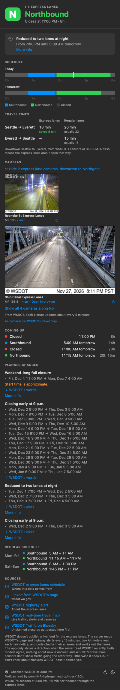
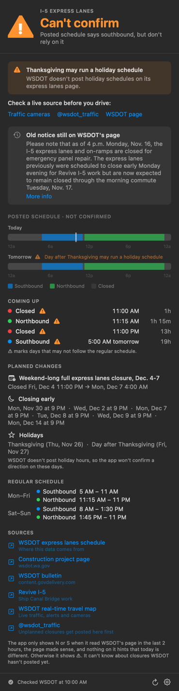
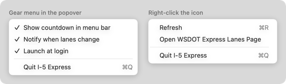

# I-5 Express for Mac Menu Bar

A macOS menu bar app that shows which way Seattle's I-5 express lanes are running right now, and whether they're open at all.

<picture>
  <source media="(prefers-color-scheme: dark)" srcset="docs/icons-dark.png">
  
</picture>

Click the icon for details: today's and tomorrow's schedule, upcoming changes, planned closures, and links to WSDOT's live sources.

<p>
  
  &nbsp;
  
</p>

## Features

### Menu bar

- A colored badge shows the current state: green **N** for northbound, blue **S** for southbound, red **✕** for closed.
- An orange dot appears on the badge when the lanes switch within 15 minutes.
- An amber **⚠** replaces the badge whenever the app can't confirm the status. See [When to trust it](#when-to-trust-it).
- You can show a countdown to the next change next to the icon. It's off by default.
- Hover over the icon to see the next change. Right-click it to refresh, open WSDOT's page, or quit.

<picture>
  <source media="(prefers-color-scheme: dark)" srcset="docs/menubar-dark.png">
  
</picture>

### Popover

- **Status:** the current direction and what happens next, like "Closes at 11:00 AM · 52m".
- **Warnings:** each reason the status can't be confirmed, with links to live sources so you can check before you drive.
- **Notices:** closures in effect now, tonight's early closure, and WSDOT notices. Notices about days that are over are grayed out.
- **Timelines:** colored bars for today and tomorrow, with a marker for the current time.
- **Coming up:** the next four changes with countdowns. A ⚠ marks days that may not follow the regular schedule.
- **Planned changes:** weekend closures, early closing dates, and holidays in the next two weeks.
- **Regular schedule and sources:** the weekly schedule as posted, and links to every page the data comes from.
- **Footer:** when the app last checked WSDOT, a refresh button (⌘R), and the settings menu.

Times are always Seattle time. If your Mac uses another time zone, the popover says so.

### Notifications

Turn on **Notify when lanes change** in the gear menu to get:

- an alert when the lanes switch direction, open or close;
- an alert when the app goes from confirmed to "can't confirm", with the reason.

To keep alerts useful, the app skips:

- the 15-minute weekday switchover gap;
- any change that happened while your Mac was asleep;
- data that's only old, like when you're offline or just woke the Mac. The menu bar still shows it.

A "can't confirm" alert also waits until the lanes are scheduled to open. So a Thanksgiving alert comes at 5 AM, not midnight.

<picture>
  <source media="(prefers-color-scheme: dark)" srcset="docs/notifications-dark.png">
  
</picture>

### Settings

The gear menu in the popover turns the countdown, notifications and launch at login on or off. Each toggle reads its real state back from macOS, so it always shows what's actually set.

<picture>
  <source media="(prefers-color-scheme: dark)" srcset="docs/menus-dark.png">
  
</picture>

The menu bar, notification and menu images are previews drawn by the app's snapshot mode (`make screenshots`), using the same icons and message text as the running app.

## When to trust it

WSDOT doesn't publish a live feed for the express lanes. This app reads [WSDOT's express lanes page](https://wsdot.wa.gov/travel/roads-bridges/express-lanes) and works out the status from the posted schedule, early closures and planned closures.

It only shows **N**, **S** or **✕** when all of these are true:

- It read WSDOT's page in the last 2 hours. It checks every 15 minutes and again when your Mac wakes up.
- Every part of the page made sense. A new section or a line it can't read counts as a problem.
- The schedule itself looks sane, with no overlapping or backwards time ranges.
- Nothing on the page suggests today is different. That includes notices dated today, undated notices, and planned closures today without exact times.
- If today closes early, the page gives the closing time.
- Today isn't a holiday. WSDOT doesn't post holiday hours.

Otherwise it shows an amber **⚠**, explains why, and links to the [travel map](https://wsdot.com/travel/real-time/map/) and [@wsdot_traffic](https://x.com/wsdot_traffic) so you can check a live source. While it's re-reading old data, for example right after your Mac wakes, it briefly shows a gray **?** instead.

If WSDOT can't be reached, the app keeps using the last good copy of the page, and shows ⚠ once that copy is more than 2 hours old.

It can't know about a closure WSDOT hasn't posted yet, like an emergency repair announced only on social media.

## Install

You need macOS 14 or later. It runs on Apple silicon and Intel Macs.

### Download

1. Download the `.dmg` from the [latest release](https://github.com/andrewmacheret/i5-macos-menubar/releases/latest).
2. Open it and drag **I-5 Express** into **Applications**.
3. Open I-5 Express from Applications. macOS says it can't check the app for malware, since the app isn't signed with an Apple developer certificate. Click **Done**.
4. Open **System Settings → Privacy & Security**, scroll down and click **Open Anyway** next to the I-5 Express message. Enter your password.
5. Open the app again. If macOS asks once more, click **Open Anyway**. The N or S badge shows up in the menu bar.

You only do steps 3 to 5 once per version.

### Build it yourself

You need the Xcode Command Line Tools (`xcode-select --install`). Full Xcode isn't required.

```bash
git clone https://github.com/andrewmacheret/i5-macos-menubar.git
cd i5-macos-menubar
make install
```

This builds `I-5 Express.app`, copies it to `~/Applications` and opens it. A build you make yourself skips the Open Anyway step, since macOS only checks downloaded apps.

The app is signed locally, not with a developer certificate. So macOS may ask you to approve notifications or launch at login again after each new version.

### Releases

GitHub Actions tests every push and builds a DMG for both Apple silicon and Intel, saved as a download on the run. Pushing a tag like `v1.0.0` also publishes the DMG as a release:

```bash
git tag v1.0.0
git push origin v1.0.0
```

## Terminal

The same logic also runs as a terminal tool:

```bash
make status
```

```
I-5 express lanes: SOUTHBOUND
  Closed at 11:00 AM (59m)
  Checked WSDOT at 10:00 AM
  Source: https://wsdot.wa.gov/travel/roads-bridges/express-lanes
```

It exits with code `0` when the status is confirmed and `2` when it isn't, so scripts can check the result. When it can't confirm, it lists the reasons.

## Development

| Command | What it does |
| --- | --- |
| `make app` | Build `build/I-5 Express.app` |
| `make dmg` | Build `build/I-5-Express.dmg` for sharing. Add `UNIVERSAL=1` for Intel too (needs full Xcode) |
| `make run` | Build and open the app from `build/` |
| `make install` | Build, copy to `~/Applications` and open |
| `make uninstall` | Quit the app and remove it |
| `make test` | Run the parser, schedule and trust tests |
| `make status` | Print the current status in the terminal |
| `make screenshots` | Regenerate the images in `docs/` |

The code is split into three parts:

- `Sources/I5Core` reads WSDOT's page (`Parser`), works out the status at any moment (`Engine`), and decides whether the status can be trusted (`Trust`). It has no UI code.
- `Sources/I5Express` is the menu bar app, built with AppKit and SwiftUI.
- `Sources/i5` is the terminal tool.

Tests run against a saved copy of WSDOT's page in `Tests/I5CoreTests/Fixtures`.

## Built with LLM tools

This project was written with LLM coding tools: an AI agent in [Cursor](https://cursor.com) wrote the code, tests and this README, directed by a human. Treat it like any other code from the internet and read it before you rely on it.

## Not affiliated with WSDOT

This is a personal project. Schedule data comes from the Washington State Department of Transportation. Always follow posted signs on the road.

## License

[MIT](LICENSE)
